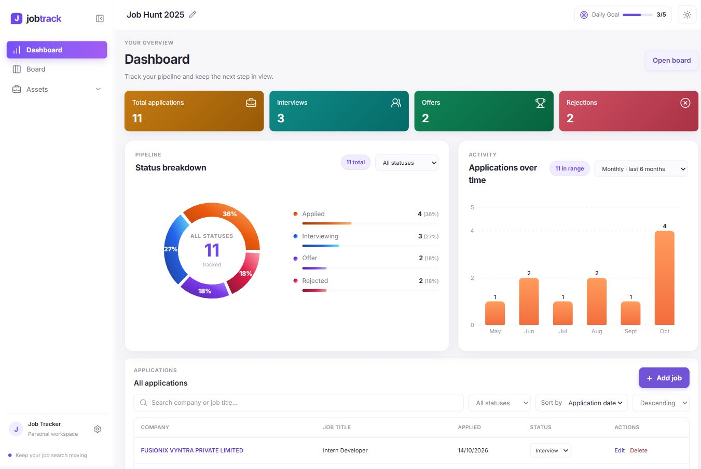
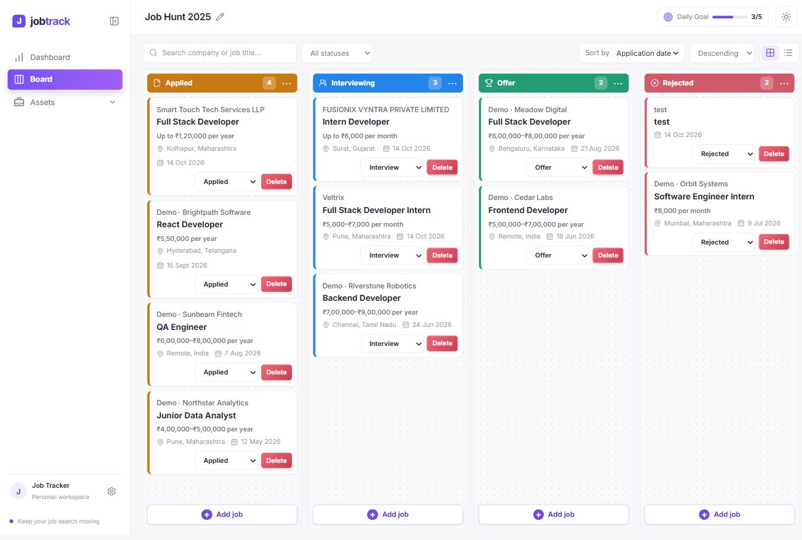
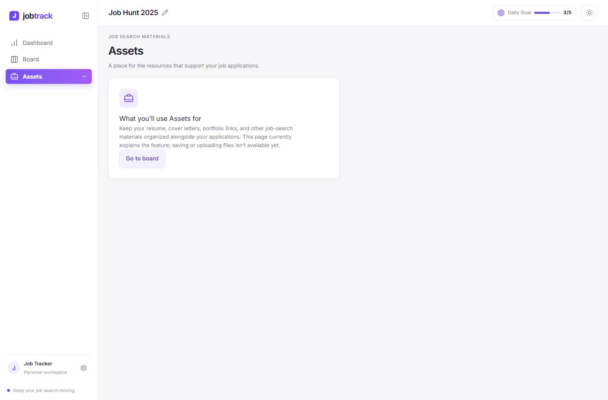
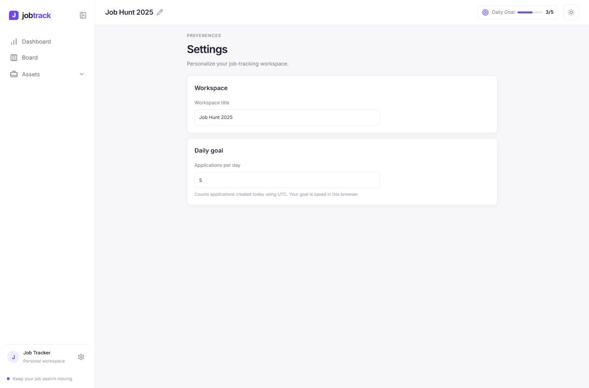
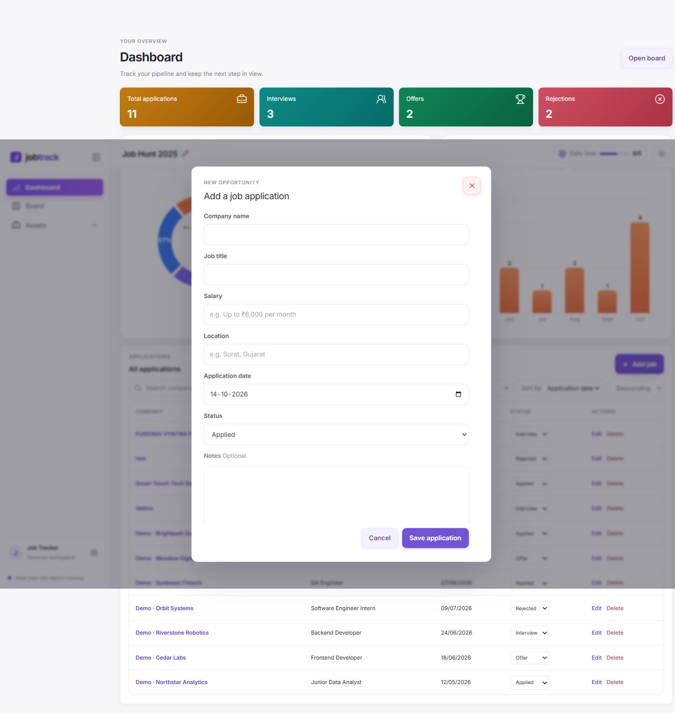
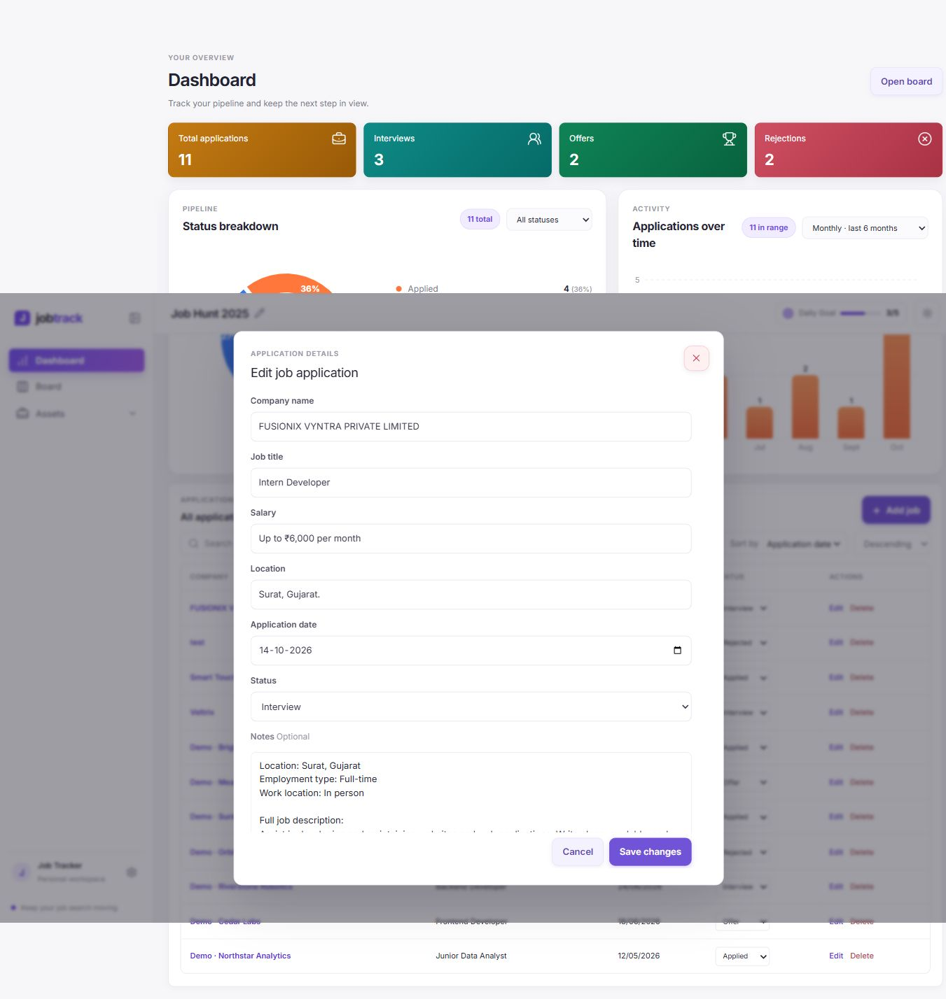
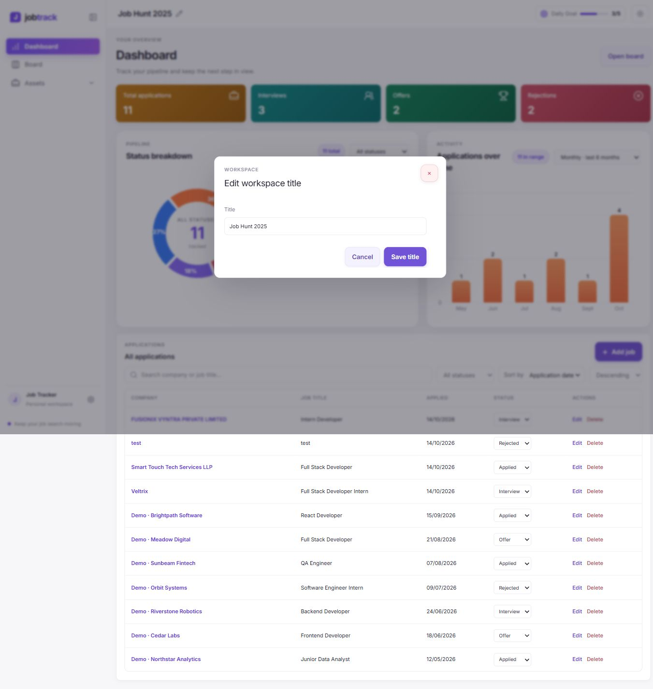

# Job Tracker

A personal job search dashboard with a searchable application list, Kanban board, status pipeline, and daily, weekly, or monthly activity chart. The React frontend stores application records through the [Job Tracker API](https://github.com/vickyy24/job-tracker-api), which persists them in MongoDB. The current deployment has no authentication; anyone who can reach it can read and change job records. Do not use it for private records until authentication is restored.

## Features

- Create, view, edit, search, sort, filter, and delete job applications.
- Track applications through Applied, Interview, Offer, and Rejected statuses in a Kanban board or table.
- See application totals, a status breakdown, and daily, weekly, or monthly activity on the dashboard.
- Filter the application list by selecting a status in the status chart or its status selector. Select the active status again to clear that filter.
- Choose the last 7 days, 8 weeks, or 6 months for the activity chart.
- Set a daily application goal and choose a light or dark theme. Workspace preferences stay in React state for the current session and reset when the page reloads.
- Record company, job title, salary or stipend, location, application date, status, and notes.

Charts use application dates. Daily activity covers the last 7 days, weekly activity covers the last 8 weeks, and monthly activity covers the last 6 months. The daily goal counts records created today in UTC. Chart totals are calculated from the full application history; the status chart can also apply its selected status to the application list.

## Product Screenshots

The screenshots below show the dashboard, application board, assets, settings, and application forms at laptop size. Sample applications are stored in MongoDB through the API seeder and are not bundled with this frontend. Hover over a status segment to view its count and percentage, or select a segment to filter the application list.

### Dashboard



### Board



### Assets



### Settings



### Add application form



### Edit application form



### Workspace form



## Run locally

Requirements: Node.js and a reachable MongoDB database.

1. Clone the [API repository](https://github.com/vickyy24/job-tracker-api), open its folder, install dependencies, and configure `MONGODB_URI` in `.env` using its `.env.example` file.

   ```sh
   npm install
   ```

2. From the API folder, optionally load a few fictional applications to preview chart changes across months and statuses:

   ```sh
   npm run seed:demo
   ```

   The seeder is safe to rerun. It adds up to seven sample applications dated May through September 2026, skips sample companies already present, and marks records with the `Demo ·` prefix. The monthly counts vary between one and two applications, and the sample statuses include Applied, Interview, Offer, and Rejected. Remove them by deleting applications with that prefix in the app or MongoDB.

3. Start the API in its folder:

   ```sh
   npm start
   ```

4. Clone this frontend repository into a separate folder, install dependencies, and start the app:

   ```sh
   npm install
   npm start
   ```

5. Open [http://localhost:3000](http://localhost:3000). By default, the frontend connects to `http://localhost:5000/api`.

To use a different API URL, create `.env.local` in this folder and set `VITE_API_BASE_URL`, then restart the frontend:

```env
VITE_API_BASE_URL=http://localhost:5000/api
```

## Deploy to Vercel and Render

The production frontend routes `/api/*` through the Vercel rewrite to `https://job-tracker-api.onrender.com`, keeping API calls on the frontend's origin without exposing a database credential in the frontend.

1. Import this frontend repository into Vercel as a Vite project. The build command is `npm run build` and the output directory is `dist` (also defined in `vercel.json`). Set `VITE_API_BASE_URL` to `/api` for Production, then deploy and note the production origin assigned by Vercel.
2. Create a Render Blueprint from the [Job Tracker API repository](https://github.com/vickyy24/job-tracker-api). In Render's environment settings, enter the Atlas URI as `MONGODB_URI` and the exact Vercel production origin as `FRONTEND_ORIGIN`. Keep the database URI in Render only; never put it in the frontend environment or source control.
3. Confirm the Render service is healthy at `/api/health`, then redeploy the Vercel project so its `/api` rewrite can reach the API.
4. The dashboard opens directly without a sign-in step. The API currently exposes application data without authentication, so restore authentication before storing private information.

The API currently uses Render's free instance in `render.yaml`; free instances may sleep while idle. Upgrade the service if always-on availability is required.

## Commands

- `npm start` starts the Vite development server at `http://localhost:3000` and opens it in the browser. Tailwind is integrated into Vite and does not run as a separate watcher.
- `npm run build` creates an optimized production build in `dist/`.
- `npm test` runs the React Scripts test runner.

## Project structure

- `src/App.js` manages application data, navigation, and modal flows.
- `src/components/` contains the dashboard, application forms, shared UI, and Kanban board.
- `src/services/applicationApi.js` contains the HTTP client for the API.
- `src/index.css` contains app styling and Tailwind directives.

## Data and limitations

- Application records are stored by the API in MongoDB. Do not put database credentials in this frontend repository.
- Authentication, multi-user workspaces, and persisted preferences are not included.
- Assets currently describes the resource library feature; uploads and document storage are not available.
